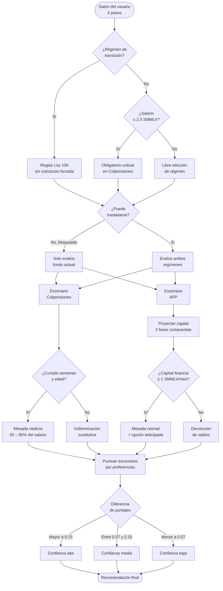

# ¿Colpensiones o AFP? · Herramienta de orientación pensional

Calculadora web que compara los dos regímenes pensionales colombianos (RPM y RAIS) y emite una recomendación personalizada. Todo el cálculo corre en el navegador — sin backend, sin registro, sin guardar datos.

## Documentación

| Doc | Contenido |
|---|---|
| [Producto](docs/producto.md) | Problema, propuesta de valor, usuarios, principios |
| [Flujo de usuario](docs/flujo.md) | Pasos del formulario, validación, pantalla de resultados |
| [Sistema de diseño](docs/diseno.md) | Colores, tipografía, componentes, principios de UX |

## Tecnología

| Capa | Detalle |
|---|---|
| Frontend | HTML + CSS + JavaScript vanilla (sin frameworks, sin dependencias) |
| Backend IA | Netlify Function (`netlify/functions/analyze.js`) → Claude Haiku via Anthropic API |
| Hosting | Netlify (configurado en `netlify.toml`) |

## Estructura

```
pension-colombia/
├── index.html                  # Toda la UI y lógica del algoritmo (SPA)
├── netlify.toml                # Configuración de build y redirect /api/analyze
├── netlify/
│   └── functions/
│       └── analyze.js          # Serverless function que llama a la Anthropic API
├── test/
│   └── algoritmo.test.js       # Tests del algoritmo (Node, sin dependencias)
└── docs/                       # Documentación de producto y diseño
```

## Desarrollo local

```bash
# Instalar Netlify CLI
npm install -g netlify-cli

# Crear archivo de variables locales
echo 'ANTHROPIC_API_KEY=sk-ant-...' > .env

# Levantar servidor local con funciones
netlify dev
```

La herramienta abre en `http://localhost:8888`. Sin la variable de entorno, el análisis IA muestra un error pero el algoritmo de comparación funciona igual.

## Despliegue en Netlify

1. Conectar el repositorio en [app.netlify.com](https://app.netlify.com)
2. En **Site settings → Environment variables**, agregar:
   ```
   ANTHROPIC_API_KEY=sk-ant-...
   ```
3. Netlify detecta automáticamente `netlify.toml` — no se requiere configuración adicional.

El endpoint `/api/analyze` se redirige a `/.netlify/functions/analyze` según `netlify.toml`.

## Tests

El algoritmo (proyección de semanas, escenarios Colpensiones/AFP, puntuación, régimen de transición) tiene una suite de tests sin dependencias. El test carga el `<script>` real de `index.html` y lo evalúa en un sandbox de Node, así que siempre corre contra el código de producción.

```bash
node --test
```

Requiere Node 18+ (usa el runner integrado `node:test`). No hay paso de build ni `package.json`.

## Algoritmo y cálculos

Todo el algoritmo corre en el navegador. El código está íntegramente en `index.html`.

### Constantes y supuestos

El algoritmo parte de las siguientes constantes fijas: la edad legal de pensión (62 años para hombres, 57 para mujeres), las 1.300 semanas mínimas de cotización, el umbral de la Reforma 2024 de 2,3 SMMLV, una tasa de aporte del 11,5% del salario a la cuenta individual en AFP, un rendimiento **real** (sobre el SMMLV) del 3% anual para el capital en AFP —con un rango de 1,5% a 4,5% para los escenarios pesimista y optimista—, el SMMLV 2026 de $1.750.905 COP como unidad de todos los valores monetarios, y una esperanza de vida de 80 años para hombres y 85 para mujeres. Todas las cifras se expresan en pesos de hoy (poder de compra actual).

El salario declarado en bandas se convierte al punto medio de la banda (por ejemplo, "2–3 SMMLV" se trata como 2,5 SMMLV).

En lugar de capturar solo la frecuencia de cotización, el formulario recoge la **trayectoria laboral futura** del usuario, que combina dos dimensiones en un único parámetro:

| Trayectoria | Factor de densidad `d` | Factor de IBC `ibc` |
|---|---|---|
| **Igual o más** — cotizaré al mismo ritmo o más | 0,92 | 1,00 |
| **Menos** — trabajaré o ganaré menos | 0,65 | 0,70 |
| **Semi-retiro** — ingresos esporádicos o de otras fuentes | 0,35 | 0,35 |

El **factor de densidad** (`d`) pondera las semanas cotizadas futuras. El **factor de IBC** (`ibc`) escala el salario declarado para obtener el salario efectivo proyectado (`efSal = salario × ibc`), que se usa tanto para el IBL en Colpensiones como para los aportes mensuales en AFP.

### Verificaciones normativas previas

Antes de calcular escenarios, el algoritmo evalúa tres condiciones que pueden restringir o contextualizar la decisión.

> **Nota normativa:** La Reforma Pensional 2024 (Ley 2381 de 2024) está **suspendida** por la Corte Constitucional (Auto 841 de 2025), que la devolvió a la Cámara por un vicio de trámite. Hoy rige la Ley 100 de 1993. Las verificaciones de transición y obligatoriedad que siguen son **condicionales**: aplicarían solo si la reforma entra en vigencia.

**Régimen de transición:** El criterio es por semanas y diferenciado por sexo (Ley 2381 art. 75): una persona quedaría en transición si al 1 de julio de 2025 tenía al menos 900 semanas (hombres) o 750 semanas (mujeres). La edad por sí sola no otorga transición. Quienes cumplan esta condición conservarían las reglas de la Ley 100 de 1993, sin la obligación de cotizar en Colpensiones por nivel de ingresos que introduce la Reforma 2024.

**Obligatoriedad por reforma:** Si la persona no está en transición y su salario es igual o menor a 2,3 SMMLV, la Reforma 2024 —de entrar en vigencia— la obligaría a cotizar en Colpensiones. La herramienta lo informa pero sigue mostrando ambos escenarios.

**Posibilidad de traslado:** Solo es posible cambiar de régimen si faltan más de 10 años para la edad legal de pensión. Si la persona ya se ha trasladado antes, se genera una advertencia sobre el bloqueo de 5 años entre traslados. Cuando el traslado no es posible, el algoritmo evalúa únicamente el escenario del fondo actual.

### Escenario Colpensiones (RPM)

El algoritmo proyecta las semanas totales sumando las semanas ya cotizadas más las que se acumularían durante los años laborales declarados, ponderadas por el factor de densidad. Con ese total verifica dos condiciones independientes: que la persona alcance la edad legal de pensión y que complete las semanas mínimas requeridas.

Las semanas mínimas parten de 1.300 y se reducen para mujeres con tres hijos o más (25 semanas menos) y con cuatro hijos o más (50 semanas menos adicionales).

Si no se cumplen ambas condiciones, el algoritmo reporta *indemnización sustitutiva* e indica si la restricción es de edad, de semanas, o de ambas.

**Tasa de reemplazo e IBL:** La mesada se expresa como porcentaje del *Ingreso Base de Liquidación* (IBL). La tasa base varía con el ingreso según la fórmula `65,5% − 0,5% × IBL` (donde IBL se mide en SMMLV), acotada entre 55% y 65%. A esa base se suman 1,5 puntos porcentuales por cada 50 semanas cotizadas sobre las 1.300, con un techo del 80%. La mesada nunca puede ser inferior a 1 SMMLV.

**Ajuste de IBL por brecha pre-retiro (Ley 100 art. 21):** El IBL legal es el promedio salarial de los 10 años anteriores a la pensión. Si el usuario declara que dejará de cotizar antes de la edad de pensión con una brecha de 2 o más años, el algoritmo prorratea el IBL proporcionalmente (`IBL ajustado = efSal × iblCotizYears / 10`).

### Escenario AFP (RAIS)

El cálculo se basa en la acumulación compuesta de capital en dos fases.

**Saldo inicial:** Si el usuario declaró su saldo real, se usa directamente. Si no, se estima a partir de las semanas cotizadas, el salario y la tasa de aporte. Los independientes reciben un ajuste a la baja en la tasa de aporte efectiva.

**Fase 1 — años laborales activos:** Mes a mes se aplica el rendimiento compuesto sobre el capital acumulado y se suma el aporte mensual (`efSal × tasa_aporte × d`). Al finalizar esta fase se agrega el bono pensional cuando aplica.

**Fase 2 — brecha hasta la edad de pensión:** Si la persona deja de cotizar antes de la edad legal, el capital sigue rentando sin nuevos aportes hasta que llegue a esa edad.

La mesada se obtiene dividiendo el capital total entre los meses de vida esperada desde el retiro. Si el resultado es de al menos 1 SMMLV mensual, se logra pensión; si no, el beneficio es la *devolución de saldos*.

**Pensión anticipada:** El algoritmo simula año a año para encontrar el primer momento en que el capital financiaría una mesada de al menos 1,1 SMMLV. Si existe ese punto y la persona tiene al menos 50 años (mujeres) o 55 (hombres), se reporta como opción de retiro anticipado.

### Puntuación y recomendación

Cada escenario recibe un puntaje compuesto sobre cinco dimensiones: probabilidad de lograr pensión, nivel de mesada, estabilidad del régimen, posibilidad de herencia y nivel de riesgo. Los pesos se ajustan según las prioridades declaradas:

- **Maximizar mesada** sube el peso de la mesada.
- **Retirarme pronto** sube el peso de lograr pensión y baja el de mesada.
- **Dejar herencia** sube el peso de herencia (las AFP permiten heredar el saldo; Colpensiones no).
- **Menor riesgo** y **Garantía del Estado** suben el peso de estabilidad.

Los pesos se normalizan para que siempre sumen 1. La diferencia entre los puntajes de los dos escenarios determina el nivel de confianza: **alta** (> 0,15), **media** (0,07–0,15), **baja** (< 0,07).

### Diagrama del flujo



---

## Contexto normativo

- **Ley 100 de 1993** — requisitos base de semanas (1.300) y edades de pensión (62H / 57M)
- **Reforma Pensional 2024 (Ley 2381 de 2024)** — hoy **suspendida** (Corte Constitucional, Auto 841 de 2025); de entrar en vigencia: obligatoriedad de cotizar en Colpensiones para ingresos ≤ 2.3 SMMLV y sistema de pilares
- **Régimen de transición** — protección para hombres con ≥ 900 semanas o mujeres con ≥ 750 semanas al 1 de julio de 2025
- **Pensión anticipada (Art. 64, Ley 100)** — retiro antes de la edad legal cuando el capital AFP financia una mesada ≥ 1.1 SMMLV

> **Aviso:** Esta herramienta es orientativa. Los cálculos son aproximaciones y no reemplazan la consulta oficial con Colpensiones, la AFP, ni un asesor pensional certificado.
