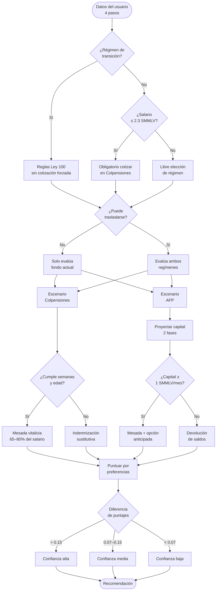

# Algoritmo y base teórica

Todo el cálculo corre en el navegador, íntegramente en `index.html`. No hay servidor ni base de datos involucrados.

## Base legal y fuentes

Cada supuesto del modelo tiene una fuente normativa o empírica explícita.

### Normas aplicadas

| Norma | Artículo | Qué regula |
|---|---|---|
| Ley 100 de 1993 | Art. 33 | Requisitos pensión RPM: 1.300 semanas y 62/57 años |
| Ley 100 de 1993 | Art. 34 (mod. Ley 797/2003) | Fórmula de tasa de reemplazo: `65,5% − 0,5% × IBL`, rango 55–80% |
| Ley 100 de 1993 | Art. 21 | IBL = promedio salarial de los 10 años anteriores a la pensión |
| Ley 100 de 1993 | Art. 64 | Pensión anticipada en AFP cuando el capital financia ≥ 1 SMMLV/mes |
| Ley 100 de 1993 | Art. 65 | Garantía de pensión mínima en RAIS (≥ 1.150 semanas) |
| Ley 100 de 1993 | Art. 101 | Rentabilidad mínima garantizada por las AFP |
| Sentencia C-197/2023 | — | Reducción escalonada de semanas mínimas para mujeres (vigente desde 2027) |
| Ley 2381 de 2024 | Art. 75 | Régimen de transición: ≥ 900 sem. (H) / ≥ 750 sem. (M) al 1-jul-2025 |
| Ley 2381 de 2024 | — | Cotización obligatoria en Colpensiones para ingresos ≤ 2,3 SMMLV |
| Auto 841 de 2025 (C. Const.) | — | Suspensión de la Ley 2381 — hoy rige la Ley 100 |
| Decreto 1469 de 2025 | — | SMMLV 2026 = **$1.750.905** |

### Supuestos propios del modelo

| Supuesto | Valor | Fuente / justificación |
|---|---|---|
| Rendimiento real AFP (base) | 3% anual | Retornos históricos de fondos moderados, serie SFC 2000–2024, descontada inflación |
| Rango rendimiento AFP | 1,5% – 4,5% | Percentiles p25–p75 de la misma serie |
| Esperanza de vida — hombres | 80 años | Tablas actuariales Colpensiones / DANE (Estudio actuarial 2022) |
| Esperanza de vida — mujeres | 85 años | Ídem |
| Tasa de aporte AFP | 11,5% del salario | Ley 100 art. 20 (cotización obligatoria) |
| Punto medio de banda salarial | Media del intervalo | Ej: "2–3 SMMLV" → 2,5 SMMLV |

> **Nota:** Los rendimientos expresados son **reales** (sobre poder de compra, no nominales). El modelo trabaja enteramente en SMMLV (pesos de hoy), por lo que no se aplica tasa nominal.

---

## Constantes

```
RET_AGE     = { H: 62, M: 57 }   // Ley 100 art. 33
BASE_WEEKS  = 1.300               // Ley 100 art. 33
GPM_WEEKS   = 1.150               // Ley 100 art. 65 (garantía pensión mínima RAIS)
REFORM_THR  = 2,3 SMMLV           // Ley 2381 art. (cotización obligatoria)
SMMLV_2026  = $1.750.905          // Decreto 1469 de 2025
REAL_RATE   = 3%                  // Supuesto empírico (ver tabla anterior)
LIFE_EXP    = { H: 80, M: 85 }   // Tablas actuariales
APORTE_RATE = 11,5%               // Ley 100 art. 20
```

---

## Trayectoria laboral futura

En lugar de capturar solo la frecuencia de cotización, el formulario recoge la **trayectoria laboral futura** del usuario — un parámetro que combina densidad de cotización y nivel de ingreso efectivo:

| Opción en UI | Factor de densidad `d` | Factor de IBC `ibc` | Interpretación |
|---|---|---|---|
| Igual o más que ahora | 0,92 | 1,00 | Cotiza casi siempre, al salario declarado |
| Menos que ahora | 0,65 | 0,70 | Pausas frecuentes o reducción de ingresos |
| Semi-retiro | 0,35 | 0,35 | Ingresos esporádicos o de otras fuentes |

- **`d`** — fracción de semanas cotizadas sobre el total posible en el período
- **`ibc`** — escala el salario declarado al ingreso base de cotización efectivo (`efSal = salario × ibc`), usado para IBL en Colpensiones y aportes en AFP

---

## Verificaciones normativas previas

Antes de calcular escenarios, el algoritmo evalúa tres condiciones:

> **Estado normativo actual:** La Ley 2381 de 2024 está **suspendida** (Auto 841/2025). Las verificaciones de transición y obligatoriedad aplican **solo si la reforma entra en vigencia**. Hoy rige la Ley 100 de 1993.

**1. Régimen de transición (Ley 2381 art. 75)**
Protege a quien al 1-jul-2025 tenía ≥ 900 semanas (hombres) o ≥ 750 semanas (mujeres). El criterio es por semanas, no por edad. Quienes califiquen conservarían las reglas de la Ley 100 sin la obligación de cotizar en Colpensiones por nivel de ingresos.

**2. Obligatoriedad por reforma**
Si el usuario no está en transición y su salario ≤ 2,3 SMMLV, la Reforma 2024 —de vigir— lo obligaría a cotizar en Colpensiones. La herramienta lo informa pero muestra ambos escenarios.

**3. Posibilidad de traslado (Ley 100)**
Solo es posible cambiar de régimen si faltan más de 10 años para la edad legal. Si ya se trasladó antes, se advierte el bloqueo de 5 años entre traslados. Si el traslado no es posible, se evalúa únicamente el fondo actual.

---

## Escenario Colpensiones (RPM)

### Semanas proyectadas

```
semanas_proy = semanas_actuales + (años_lab × 52 × d)
```

### Semanas mínimas requeridas

```
min_sem = 1.300
  − 25  si mujer con ≥ 3 hijos   (Sentencia C-197/2023)
  − 25  si mujer con ≥ 4 hijos   (descuento adicional)
```

### Condiciones para pensión

1. `edad_retiro ≥ RET_AGE`
2. `semanas_proy ≥ min_sem`

Si no se cumplen → **indemnización sustitutiva** (devolución de aportes, sin mesada).

### Tasa de reemplazo (Ley 100 art. 34)

```
tasa_base = 65,5% − 0,5% × IBL_en_SMMLV      // entre 55% y 65%
tasa      = tasa_base + 1,5% × floor((semanas_proy − 1.300) / 50)
tasa      = min(tasa, 80%)
```

### IBL — Ingreso Base de Liquidación (Ley 100 art. 21)

IBL legal = promedio salarial de los 10 años previos al retiro. El modelo usa `efSal` como proxy. Si hay brecha pre-retiro ≥ 2 años:

```
iblCotizYears = 10 − gapYears
IBL_ajustado  = efSal × (iblCotizYears / 10)
```

### Mesada

```
mesada = max(IBL × tasa, 1 SMMLV)
```

---

## Escenario AFP (RAIS)

### Saldo inicial

Si el usuario declara su saldo real → se usa directamente.  
Si no → estimado a partir de semanas, salario y tasa de aporte, con factor de rendimientos históricos acumulados.

Independientes: ajuste a la baja en tasa de aporte efectiva (cotizan habitualmente sobre IBC menor).

### Proyección en dos fases

**Fase 1 — años laborales activos**

```
// mes a mes
capital = capital × (1 + r_mensual) + efSal × APORTE_RATE × d
```

Al final de fase 1: se suma bono pensional si aplica (trabajo en entidad pública antes de 1994).

**Fase 2 — brecha hasta edad legal**

Si `edad_retiro < RET_AGE`:
```
capital = capital × (1 + r)^(RET_AGE − edad_retiro)   // solo rendimiento, sin aportes
```

### Mesada

```
meses_vida = (LIFE_EXP − RET_AGE) × 12
mesada     = capital / meses_vida
```

Si `mesada ≥ 1 SMMLV` → pensión. Si no → **devolución de saldos**.

### Pensión anticipada (Ley 100 art. 64)

El algoritmo simula año a año desde la edad actual. Encuentra el primer año en que `capital_proyectado / meses_vida_restante ≥ 1,1 SMMLV`. Si ese año existe y la persona tiene ≥ 55 años (H) / ≥ 50 años (M), se reporta como opción de retiro anticipado.

---

## Puntuación y recomendación

Cada escenario recibe un puntaje sobre 5 dimensiones:

| Dimensión | Descripción |
|---|---|
| `logra` | Probabilidad de alcanzar pensión completa |
| `mesada` | Nivel de mesada normalizado entre los escenarios disponibles |
| `estabilidad` | Colpensiones: alta (Estado garantiza). AFP: media (mercado) |
| `herencia` | AFP: alta (saldo heredable). Colpensiones: baja (no hay cuenta individual) |
| `riesgo` | Inverso del riesgo del régimen |

Los pesos base se ajustan según las preferencias declaradas en el paso 4:

| Preferencia | Efecto |
|---|---|
| Maximizar mesada | ↑ peso mesada |
| Retirarme pronto | ↑ peso logra, ↓ peso mesada |
| Dejar herencia | ↑ peso herencia |
| Menor riesgo / Garantía del Estado | ↑ peso estabilidad |

Los pesos se normalizan para que sumen 1.

### Nivel de confianza

```
diff = |score_A − score_B|

alta  → diff > 0,15
media → 0,07 < diff ≤ 0,15
baja  → diff ≤ 0,07
```

Una confianza baja indica que la diferencia entre regímenes es marginal con las preferencias declaradas — conviene buscar asesoría profesional.

---

## Diagrama del flujo


